<p align="center">
  
</p>

<p align="center">
  <b>Una semana de turnos de nivel 1 en el SOC de una empresa ficticia: 40 alertas con registros reales y ruido, decisiones que se corrigen al momento y un historial que puedes llevar a la entrevista. Un solo HTML, sin servidor, sin cuenta y sin una sola petición a Internet.</b>
</p>

<p align="center">
  <a href="https://heindall92.github.io/bluejr/"></a>
</p>

<p align="center">
  <a href="LICENSE"></a>
  
  
  
  
  
  
  
  
  
</p>

<p align="center">
  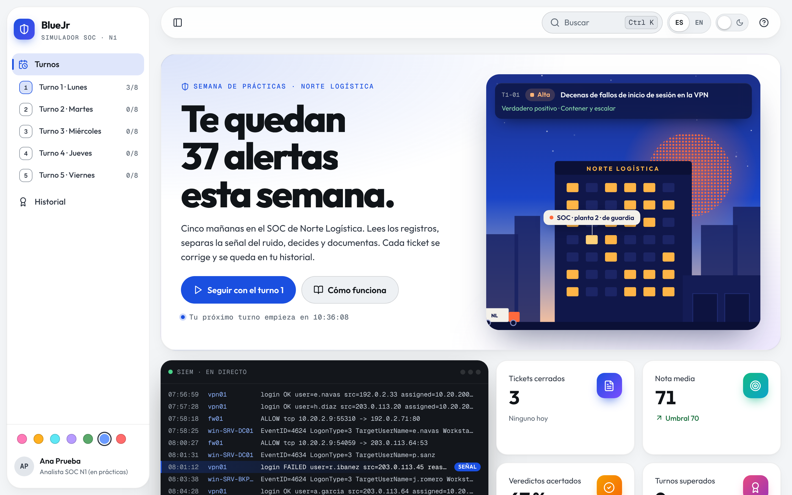
</p>

Para el primer empleo en ciberseguridad piden experiencia, y para tener experiencia hace falta el primer empleo. Las certificaciones y los CTF demuestran que *sabes*; no demuestran que *has trabajado*: qué haces el lunes a las 9 con una cola de alertas, mucho ruido y un ticket que escribir. **BlueJr te da esa semana:**

- **40 alertas** en cinco turnos, de lunes a viernes, en **Norte Logística**, una empresa inventada con su inventario, sus personas y su red;
- **registros de verdad** (eventos de Windows, cortafuegos, proxy, correo, EDR, DNS, Entra ID, WAF) mezclados con **ruido determinista** que nunca cita a las personas ni a los equipos del caso;
- una **intrusión que avanza** durante la semana, y también escaneos autorizados, parches con cambio aprobado, un pentest contratado y reglas mal escritas: la mitad del trabajo de un nivel 1 es **no** escalar lo que no toca;
- **corrección al cerrar cada ticket**, con lo esperado y el porqué;
- un **historial exportable** en Markdown con tus tickets, evidencias, relevos y competencias.

<div align="center">

## `$ cat bluejr.yaml`

<table>
  <thead>
    <tr>
      <th colspan="2" align="left"><code>bluejr:~$ cat bluejr.yaml</code></th>
    </tr>
  </thead>
  <tbody>
    <tr>
      <td width="50%" valign="top"><code>├─ ⚑ contenido:</code><br><br>
        
        
        <br>
        <sub><code>27 verdaderos positivos · 4 falsos positivos · 9 benignos · MITRE ATT&CK por ID · competencias del perfil ECSF «Cyber Incident Responder»</code></sub>
      </td>
      <td width="50%" valign="top"><code>├─ ✦ aplicacion:</code><br><br>
        
        
        
        <br>
        <sub><code>sin framework · motor sin DOM · un único HTML de unos 300 KB · Web Animations API</code></sub>
      </td>
    </tr>
    <tr>
      <td valign="top"><code>├─ ◉ diseño:</code><br><br>
        
        <br>
        <sub><code>Outfit + Geist Mono · oscuro sin negro ni blanco puros · claro · 7 acentos · entrada en menos de 450 ms</code></sub>
      </td>
      <td valign="top"><code>├─ ⚙ build_ci_cd:</code><br><br>
        
        
        <br>
        <sub><code>build propio con CSP por hashes · Playwright + axe en la CI · Pages publica cada push a main</code></sub>
      </td>
    </tr>
    <tr>
      <td valign="top"><code>├─ ◈ pruebas:</code><br><br>
        
        
        <br>
        <sub><code>cada caso se resuelve leyendo sus registros · red bloqueada en el e2e · claro y oscuro, 1440 y 390 px</code></sub>
      </td>
      <td valign="top"><code>╰─ ⌁ privacidad:</code><br><br>
        
        
        <br>
        <sub><code>progreso en localStorage · copia en JSON saneada al importar · connect-src 'none'</code></sub>
      </td>
    </tr>
  </tbody>
  <tfoot>
    <tr>
      <td colspan="2"><code>version: 0.2.0&nbsp;&nbsp;·&nbsp;&nbsp;nivel: SOC N1&nbsp;&nbsp;·&nbsp;&nbsp;empresa: Norte Logística (ficticia)&nbsp;&nbsp;·&nbsp;&nbsp;licencia: MIT</code></td>
    </tr>
  </tfoot>
</table>

</div>

---

##  Novedades

### 0.2.0 · noviembre de 2026

- **Portada nueva:** titular gigante que entra palabra a palabra, cuenta atrás hasta el turno de las 08:00 y una escena ilustrada del amanecer en Norte Logística: sale el sol con trama de puntos, la sede sube, sus ventanas se encienden una a una y la del SOC late con su etiqueta y la burbuja del último ticket. Debajo, una consola en directo donde los registros pasan como ruido, una línea se enciende como señal y se convierte en un ticket clasificado. Debajo, tarjetas de estadísticas con icono en degradado que se elevan al pasar el ratón, y el botón para seguir donde lo dejaste.
- **Movimiento con oficio:** la entrada de cada vista dura menos de 450 ms, solo anima transform y opacity, se reproduce solo al cambiar de vista y nunca mueve lo que tiene el foco. Las cifras se cuentan al llegar.
- **Barra lateral plegable** a un carril de iconos (botón o tecla `[`): se despliega por encima del contenido al pasar el ratón o al entrar con el teclado. La sección activa lleva una píldora que se desliza y cada sección tiene su gesto en el icono.
- **Modo oscuro según la guía de superficies:** sin negro puro ni blanco puro (superficies `#1D2127` y `#252930`, texto `#D1D7E0` y `#AAAEB6`) y profundidad con sombras en lugar de bordes.
- **Tipografía Outfit** en toda la aplicación (Geist Mono para registros e identificadores).

### 0.1.0

- Primera versión: cinco turnos, 40 alertas, corrección, relevo e historial exportable.

---

## Índice

- [Novedades](#-novedades)
- [Cómo se usa](#-cómo-se-usa)
- [Mapa mental](#-mapa-mental)
- [Vistas](#-vistas)
- [Cómo se corrige](#-cómo-se-corrige)
- [Capturas](#-capturas)
- [Movimiento y diseño](#-movimiento-y-diseño)
- [Arranque rápido](#-arranque-rápido)
- [Arquitectura](#-arquitectura)
- [Privacidad y seguridad](#-privacidad-y-seguridad)
- [Pruebas](#-pruebas)
- [Hoja de ruta](#-hoja-de-ruta)
- [Limitaciones conocidas](#-limitaciones-conocidas)
- [Estructura](#-estructura)
- [Licencia](#-licencia)
- [Autor](#-autor)

---

##  Cómo se usa

1. **Abre un turno.** Cada turno es una mañana con ocho alertas ordenadas por hora en la **regleta del turno**: el tamaño de cada marca dice su severidad y el color, si la has cerrado bien.
2. **Investiga.** Lee la alerta y sus registros, filtra por texto (`/`) o por fuente y separa la señal del ruido.
3. **Decide.** Veredicto (verdadero positivo, falso positivo o benigno) y acción (cerrar, escalar a N2 o contener y escalar).
4. **Documenta.** Rellena los datos clave (IP, cuentas, equipos, cambios, ID de MITRE ATT&CK), fija las líneas que lo demuestran y escribe el ticket.
5. **Aprende.** Al cerrar ves la nota, lo esperado y una explicación de por qué.
6. **Entrega el relevo** al terminar el turno y **exporta tu historial** para la entrevista.

##  Mapa mental

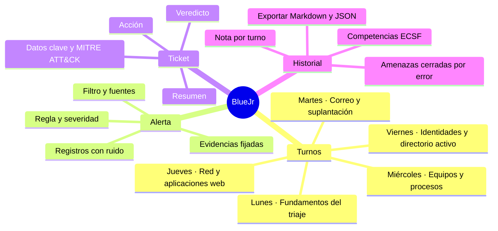

<details>
<summary><b>La semana en Norte Logística</b> (contiene pistas: ábrelo después de jugar)</summary>

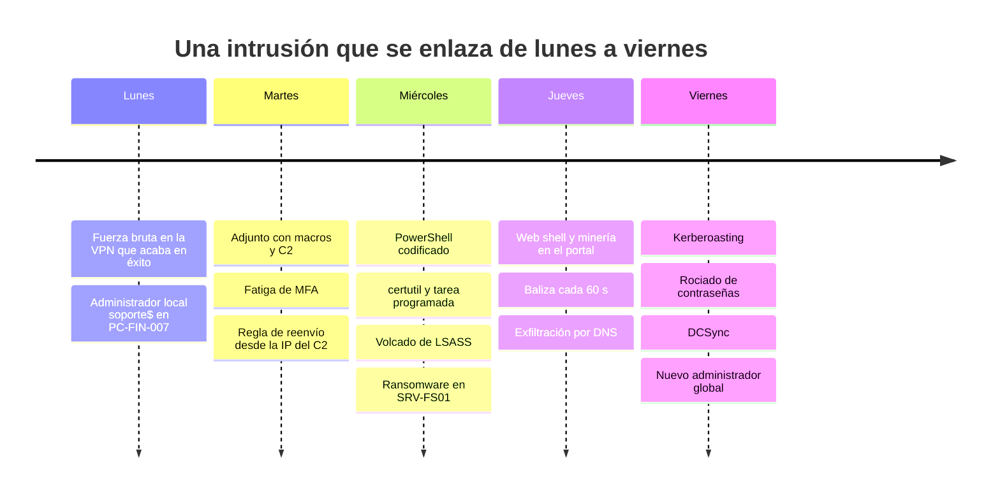

</details>

##  Vistas

| | Vista | Contenido |
|---|---|---|
|  | **Portada** | Escena del amanecer con la ventana del SOC, cuenta atrás del turno, consola en directo, siguiente paso recomendado, tarjetas de estadísticas y los cinco turnos con su regleta. |
|  | **Turno** | Regleta, cola de alertas, alerta con registros filtrables y evidencias, ticket y corrección. Al completar el turno, informe de relevo. |
|  | **Historial** | Tickets cerrados, nota media, veredictos acertados, amenazas cerradas por error, competencias, turnos y tickets; exportar e importar. |
|  | **Búsqueda** (`Ctrl K`) | Secciones, alertas y glosario. Nunca desvela respuestas: busca por la regla, no por la técnica. |
|  | **Ayuda** (`?`) | Guía, método de corrección generado desde el código, empresa y datos, atajos, glosario y acerca de. |

##  Cómo se corrige

Cada ticket vale 100 puntos. Las cifras salen de las constantes del motor (`src/engine/bluejr-engine.js`) y una prueba comprueba que este README coincide con ellas.

| Criterio | Puntos |
|---|---|
| Veredicto correcto | 40 |
| Acción correcta | 25 |
| Datos clave (en proporción a los aciertos) | 25 |
| Ticket: la mitad por llegar a 60 caracteres y la otra mitad por citar al menos la mitad de los datos del caso | 10 |

Un turno se supera con sus ocho alertas cerradas y una nota media de **70** o más. En el ID de MITRE ATT&CK vale la subtécnica o la técnica padre.

##  Capturas

<table>
<tr>
<td width="50%">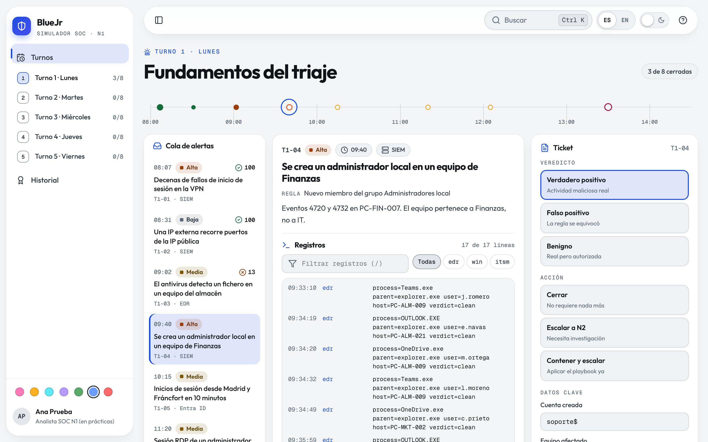<br/><sub><b>Turno</b> · regleta, cola, alerta con registros y ticket</sub></td>
<td width="50%">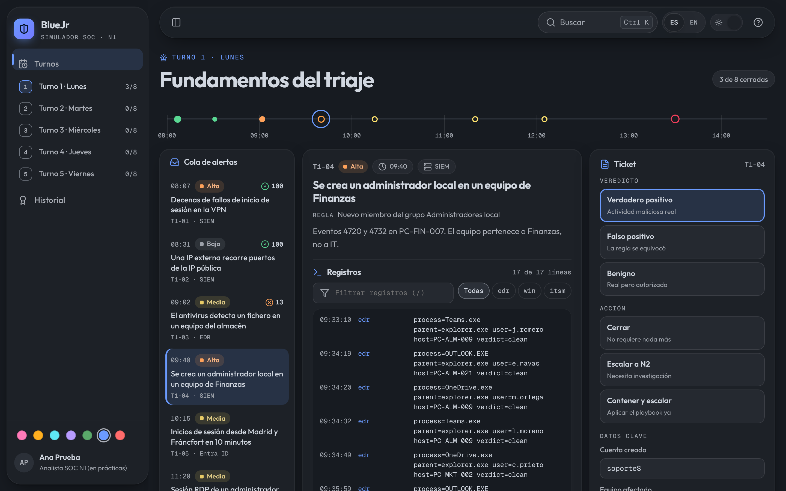<br/><sub><b>Turno</b> · en oscuro, superficies #1D2127 y #252930</sub></td>
</tr>
<tr>
<td>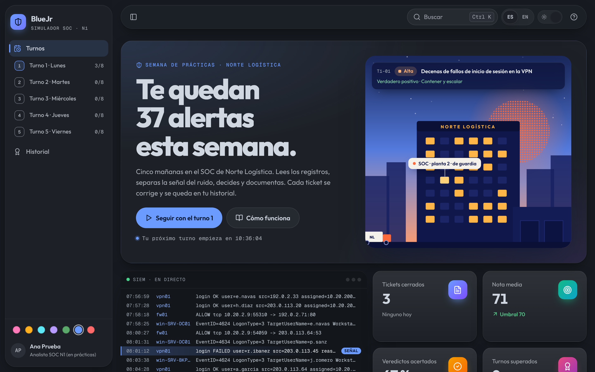<br/><sub><b>Portada</b> · en oscuro</sub></td>
<td>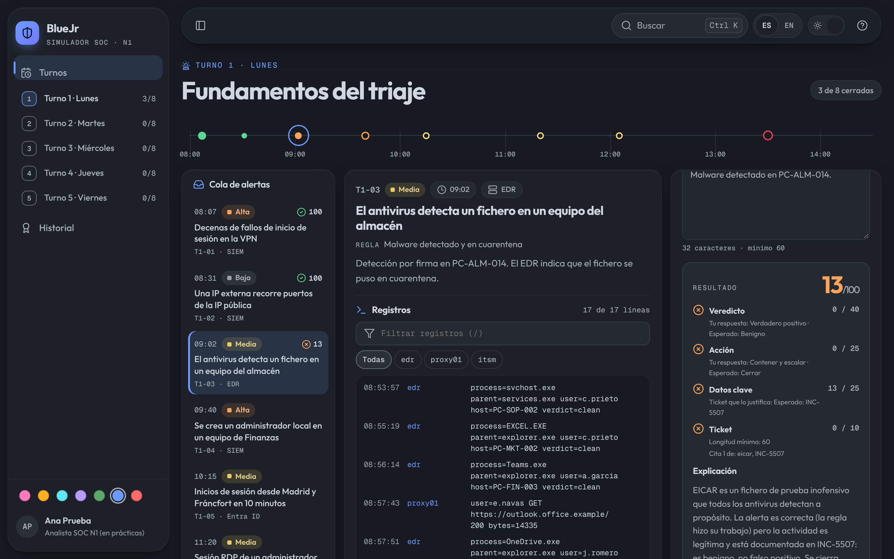<br/><sub><b>Corrección</b> · nota, lo esperado y la explicación</sub></td>
</tr>
<tr>
<td>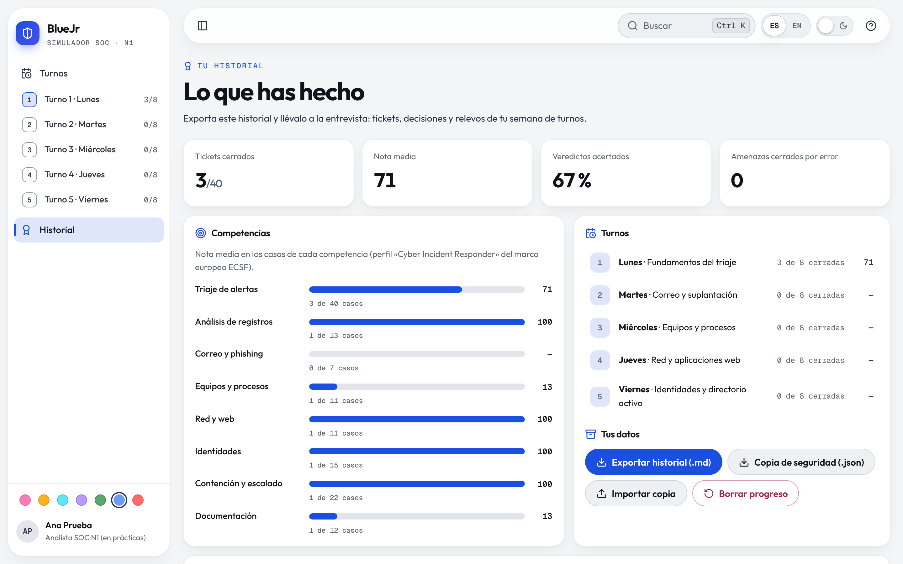<br/><sub><b>Historial</b> · indicadores, competencias y turnos</sub></td>
<td>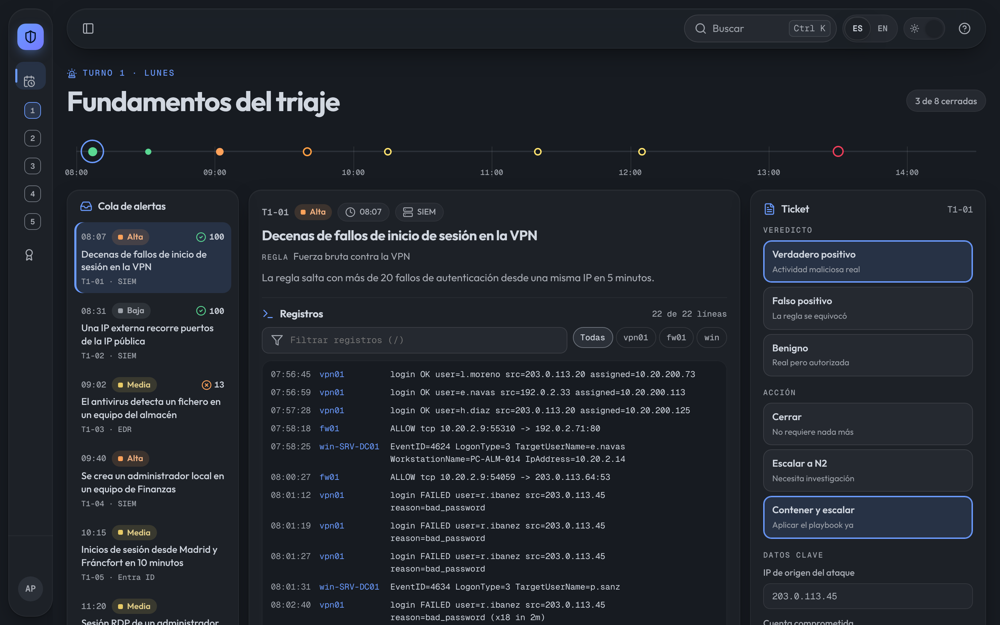<br/><sub><b>Lateral plegado</b> · carril de iconos con el número de cada turno</sub></td>
</tr>
</table>

**En inglés.** El selector ES/EN de la barra superior cambia la interfaz y el contenido de los 40 casos.

<p align="center">
  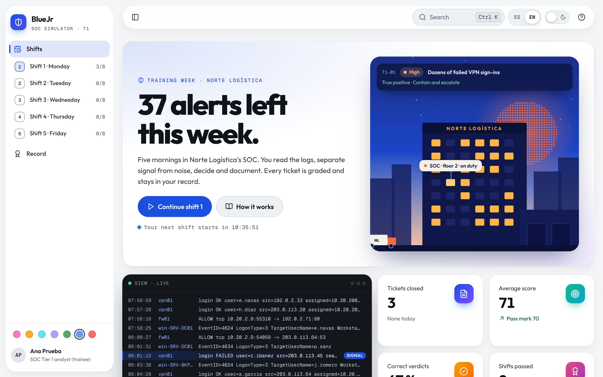
</p>

**Siete acentos.** Rosa, solar, glaciar, orquídea, verde bosque, azul eléctrico (por defecto) y rojo, en el pie del lateral.

<table>
<tr>
<td width="33%">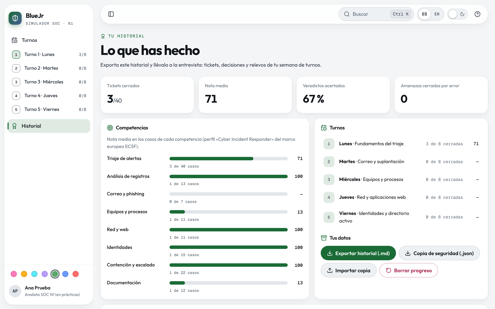<br/><sub><b>Verde bosque</b></sub></td>
<td width="33%">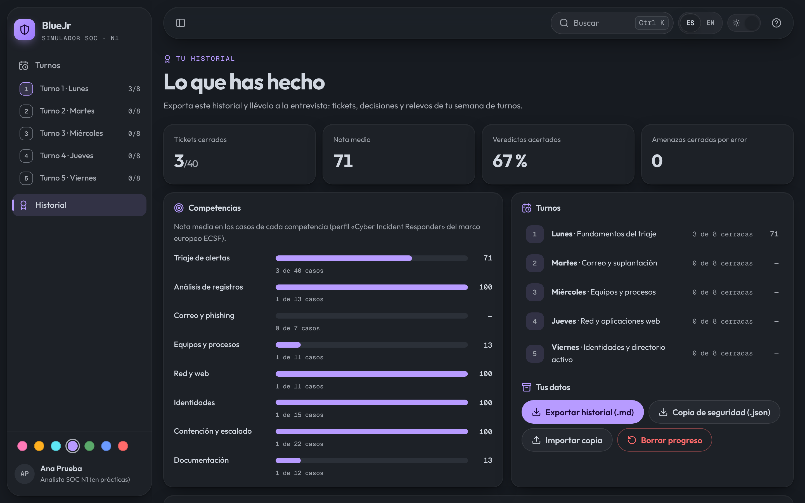<br/><sub><b>Orquídea</b> · oscuro</sub></td>
<td width="33%">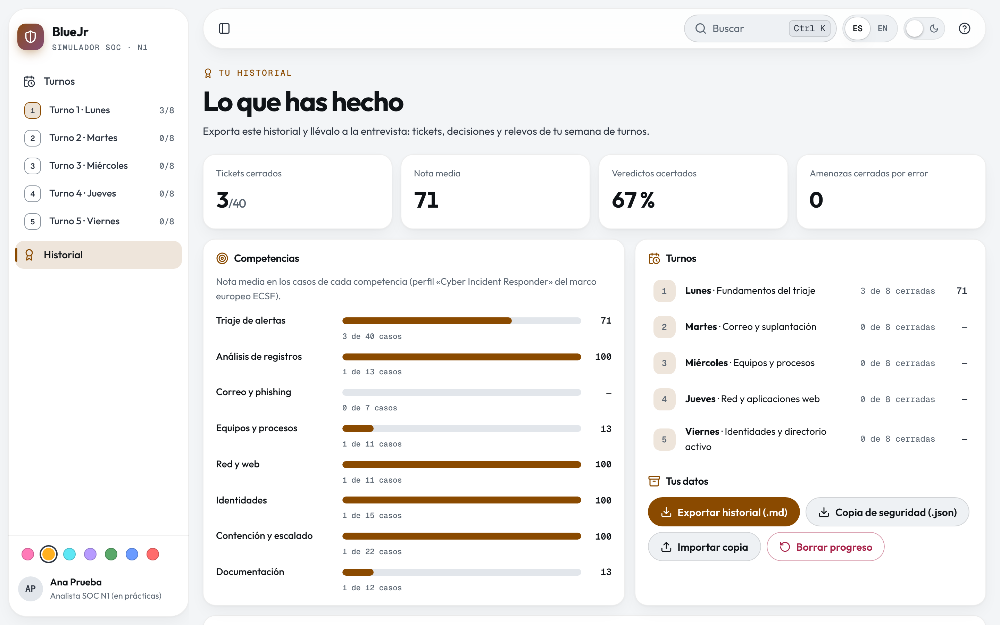<br/><sub><b>Solar</b></sub></td>
</tr>
</table>

<p align="center">
  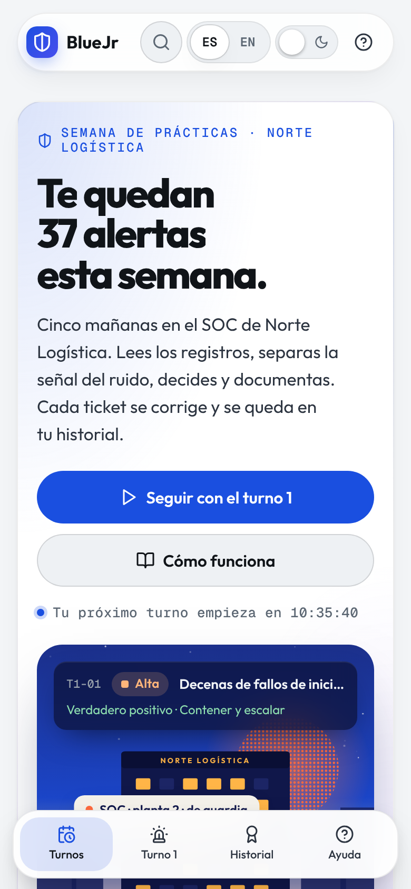
  &nbsp;
  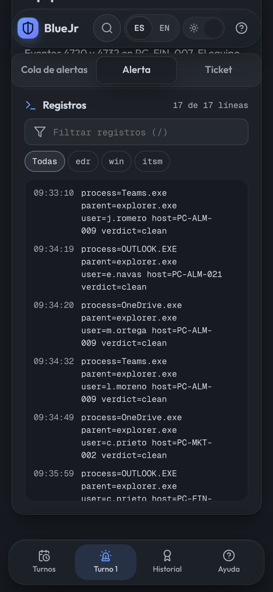
  &nbsp;
  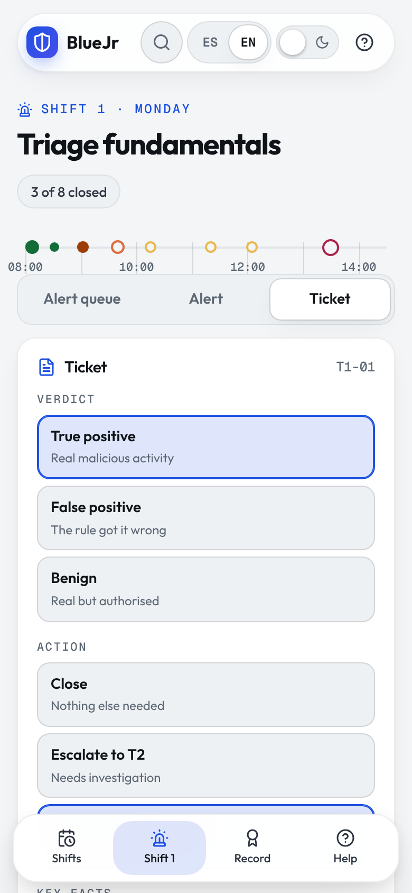
</p>

##  Movimiento y diseño

Siguiendo los principios de Emil Kowalski y el diseño de Apple:

| Pieza | Comportamiento |
|---|---|
| Entrada de cada vista | Cabecera ya, hasta 7 piezas escalonadas 28 ms, 240 ms cada una; todo termina antes de **450 ms**. Solo al cambiar de vista. |
| Tarjetas | Se elevan 5 px al pasar el ratón (solo con ratón y sin «reducir movimiento»); quietas mientras se trabaja con teclado dentro. |
| Lateral | Píldora activa que se desliza; carril plegable que se despliega por encima; gesto propio en el icono de cada sección. |
| Consola de la portada | Sube una línea cada 1,3 s y se pausa si la pestaña no está visible. Decorativa: no la lee el lector de pantalla. |
| Escena del amanecer | SVG en el propio archivo, sin imágenes externas. Al cargar: sol (1,4 s), sede, ventanas escalonadas, etiqueta del SOC y burbuja. Solo se reproduce al entrar en la vista; con «reducir movimiento» aparece entera al instante. Decorativa (`aria-hidden`). |
| Movimiento reducido | Sin desplazamientos ni bucles; las cifras aparecen ya contadas. |

Paleta oscura sin negro ni blanco puros (superficies `#1D2127` / `#252930`, texto `#D1D7E0` / `#AAAEB6`, sombras con un brillo de 1 px arriba), tipografía **Outfit** en toda la interfaz y **Geist Mono** en registros e identificadores. Iconos solo de **Lucide**.

##  Arranque rápido

**En el navegador:** abre [heindall92.github.io/bluejr](https://heindall92.github.io/bluejr/).

**Sin conexión:** descarga [bluejr.html](bluejr.html) y ábrelo con doble clic. Es el mismo fichero que se publica.

**Desarrollo** (Node 20 o superior):

```bash
git clone https://github.com/heindall92/bluejr.git
cd bluejr
npm ci
npm run build      # src/ → dist/index.html y bluejr.html
npm test           # motor, integridad de los 40 casos y coherencia del repositorio
npm run test:e2e   # navegador real con la red bloqueada, y axe
npm run capturas   # regenera docs/capturas/
```

Atajos: `Ctrl K` / `⌘K` buscar · `/` filtrar registros · `J` / `K` alerta siguiente o anterior · `[` plegar el lateral · `?` ayuda · `Esc` cerrar.

##  Arquitectura

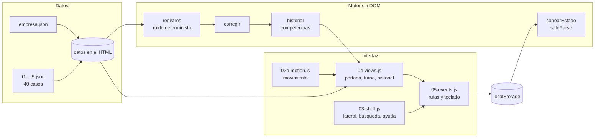

- **Un único HTML**: `scripts/build.mjs` incrusta datos, motor, interfaz, estilos y fuentes, y calcula la CSP con los hashes de cada bloque.
- **Motor sin DOM** (`src/engine/`): funciones puras y deterministas que prueban las unitarias con `require()`.
- **Datos separados**: añadir un turno es añadir un fichero en `src/data/`; `tests/casos.test.mjs` comprueba que se pueda resolver.

##  Privacidad y seguridad

- **Local-first.** Todo se guarda en el `localStorage` de tu navegador. Sin cuentas, servidor ni telemetría.
- **Cero peticiones.** CSP por hashes (`default-src 'none'`, `connect-src 'none'`), fuentes incrustadas e iconos en línea. El e2e bloquea cualquier URL que no sea `file:`, `data:` o `blob:` y la cuenta como fallo.
- **Entrada hostil.** La importación descarta claves de prototipo, valida tipos, listas y longitudes, y **recalcula las notas**: una copia no puede inventarse resultados. Todo texto se escapa antes de llegar al HTML (con prueba de mutación).

Detalle en [SECURITY.md](SECURITY.md).

##  Pruebas

| Suite | Pruebas | Qué cubre |
|---|---|---|
| Motor | 16 | Corrección por criterio, normalización, MITRE, ruido determinista que nunca cita entidades del caso, historial, saneado de importaciones, CSV contra fórmulas |
| Casos | 7 | Cada caso se resuelve leyendo sus registros, textos bilingües, solo IP de documentación y dominios `.example`, referencias cruzadas válidas |
| Repositorio | 6 | HTML al día, CSP sin `unsafe-inline` en scripts, paridad de claves ES/EN, versión única, enlaces y cifras de este README |
| E2E | 14 | Alerta de punta a punta, teclado, ayuda, inglés sin restos de español, exportar e importar, importación hostil, relevo, móvil, tema, movimiento (entrada antes de 450 ms), lateral plegable y portada |
| Accesibilidad | 4 | axe en vistas, estados y todos los diálogos, en claro y oscuro, a 1440 y 390 px: 0 infracciones |

##  Hoja de ruta

Detalle en [ROADMAP.md](ROADMAP.md).

- [x] 0.1.0 · Primera semana: cinco turnos, corrección, relevo e historial
- [x] 0.2.0 · Portada, movimiento, lateral plegable, modo oscuro y tipografía
- [ ] 0.3.0 · Turnos con reloj: SLA por severidad y alertas que llegan mientras trabajas
- [ ] 0.4.0 · Segunda semana: nube y SaaS
- [ ] 0.5.0 · Del ticket a la entrevista: historial en PDF y tickets como historias STAR para Astrolabio

##  Limitaciones conocidas

- Los casos son ficticios y están escritos a mano: enseñan el razonamiento de un nivel 1, no sustituyen la experiencia en un SOC real.
- La corrección es automática: compara con una solución por caso y busca datos en el ticket; no valora el estilo de la redacción.
- El progreso vive en el navegador: si borras sus datos, se pierde. Usa **Historial → Copia de seguridad**.
- Las notas de ITSM de los registros están en español también en inglés, como en una empresa española.

##  Estructura

```
bluejr/
│
├── 🧩 src/
│   ├── index.html                Plantilla del único HTML
│   ├── engine/bluejr-engine.js   Motor sin DOM: registros, corrección, historial, saneado
│   ├── app/
│   │   ├── 00-i18n.js            Español / English
│   │   ├── 01-core.js            Estado, preferencias, utilidades y descargas
│   │   ├── 02-icons.js           Iconos Lucide en línea (generado)
│   │   ├── 02b-motion.js         Movimiento: entrada, cifras y píldora del lateral
│   │   ├── 03-shell.js           Lateral, barra superior, búsqueda, ayuda y perfil
│   │   ├── 04-views.js           Portada, turno e historial
│   │   └── 05-events.js          Eventos, teclado y arranque
│   ├── data/                     empresa.json y t1…t5.json (40 casos)
│   ├── styles/bluejr.css         Tokens, claro y oscuro, siete acentos, móvil
│   └── fonts/                    Outfit y Geist Mono (OFL)
│
├── 🛠️ scripts/                   build.mjs · iconos.mjs · capturas.mjs
├── 🧪 tests/                     Motor, casos, repositorio, e2e y accesibilidad
├── 📄 docs/                      Capturas, cabecera, pie e iconos del README
├── 🌐 bluejr.html · dist/        El HTML compilado (descargable y publicado)
└── ⚖️ LICENSE                    MIT
```

##  Licencia

© 2026 Yoandy Ramírez Delgado. Código y contenido bajo licencia [MIT](LICENSE).

Componentes de terceros: iconos de [Lucide](https://lucide.dev) (ISC) y fuentes Outfit y Geist Mono (SIL Open Font License, en `src/fonts/`). BlueJr es un proyecto independiente con fines formativos: no está afiliado ni respaldado por MITRE, ENISA ni ningún fabricante. MITRE ATT&CK® es marca registrada de The MITRE Corporation y las técnicas se citan solo por su ID. Empresa, personas, equipos, IP (RFC 5737) y dominios (`.example`) son inventados.

##  Autor

<table>
<tr>
<td align="center" width="100%" valign="top">
<br/>
<b>Yoandy Ramírez Delgado</b><br/>
<sub><b>Diseño y desarrollo de BlueJr</b></sub><br/>
<sub>Junior Pentester · eJPTv2 · AI Governance (ISO 42001) · SysAdmin</sub><br/><br/>
<a href="https://www.linkedin.com/in/yoandyrd92/"></a>
<a href="https://github.com/heindall92"></a>
<a href="https://yoandyramirez.com"></a>
<a href="https://profile.hackthebox.com/profile/019c5812-b4ca-7315-b12f-14db6d2b42fa"></a>
</td>
</tr>
</table>

Otras herramientas del autor: [Rosetta](https://github.com/heindall92/rosetta_multinorma) (mapa multinorma), [Atlas GRC](https://github.com/heindall92/atlas-grc) (aprender ISO/IEC 27001 desde cero), [ARGOS](https://github.com/heindall92/argos-grc) (laboratorio GRC), [CTEM-Nexus](https://github.com/heindall92/ctem-nexus) (exposición y rutas de ataque), [ENS Compliance Studio](https://github.com/heindall92/grc_ens_compliance_studio), [KAIROS](https://github.com/heindall92/kairos) (continuidad de negocio) y [Astrolabio](https://github.com/heindall92/astrolabio) (entrevistas con el método STAR).

Errores o propuestas: abre una *issue* o escribe a <a href="mailto:yoandyramirezdelgado@gmail.com">yoandyramirezdelgado@gmail.com</a>.

<p align="center">
  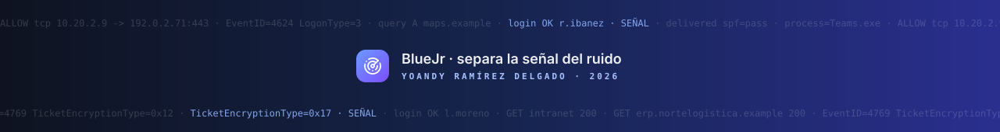
</p>
