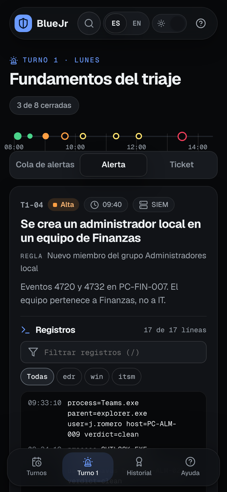
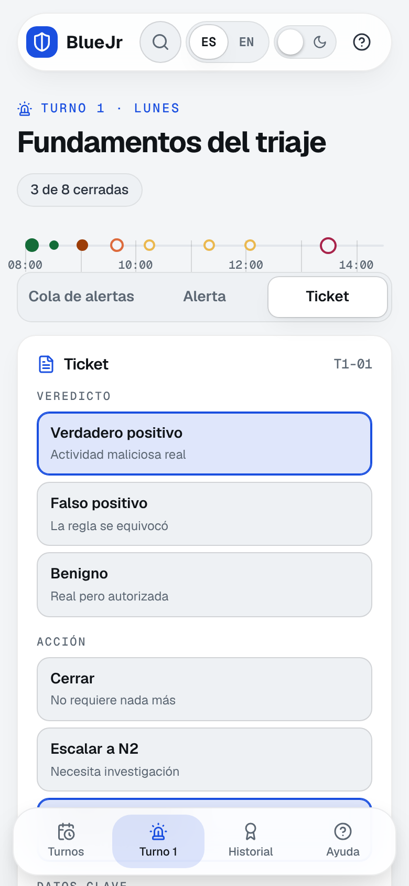

<h1 align="center">BlueJr</h1>

<p align="center"><b>Tu primer turno como analista SOC, antes de tu primer empleo.</b><br>
Una semana de turnos de nivel 1 en una empresa ficticia: alertas reales, registros con ruido, decisiones que se corrigen y un historial que puedes llevar a la entrevista. Un solo HTML, sin servidor, sin cuenta y sin peticiones a Internet.</p>

<p align="center">
  <a href="https://heindall92.github.io/bluejr/">Demo en GitHub Pages</a> ·
  <a href="bluejr.html">bluejr.html</a> (descárgalo y ábrelo) ·
  <a href="CHANGELOG.md">Versión 0.1.0</a> ·
  <a href="LICENSE">MIT</a>
</p>


## El problema

Para el primer empleo en ciberseguridad piden experiencia, y para tener experiencia hace falta el primer empleo. Las certificaciones y los CTF demuestran que *sabes*; no demuestran que *has trabajado*: qué haces el lunes a las 9 con una cola de alertas, mucho ruido y un ticket que escribir. BlueJr te da esa semana.

## Qué haces

| Paso | En BlueJr |
|---|---|
| Abres un turno | Cinco mañanas (lunes a viernes) con ocho alertas cada una, ordenadas por hora en la **regleta del turno** |
| Investigas | Lees la alerta y sus registros (Windows, cortafuegos, proxy, correo, EDR, DNS, Entra ID, WAF), filtras por texto o por fuente y separas la señal del ruido |
| Decides | **Veredicto** (verdadero positivo, falso positivo o benigno) y **acción** (cerrar, escalar a N2 o contener y escalar) |
| Documentas | Rellenas los datos clave (IP, cuentas, equipos, cambios, ID de MITRE ATT&CK), fijas las líneas que lo demuestran y escribes el ticket |
| Aprendes | Al cerrar ves la nota, lo esperado y una explicación de por qué |
| Entregas el relevo | Al terminar el turno escribes lo que el siguiente analista debe saber |
| Lo enseñas | Exportas tu historial en Markdown: tickets, evidencias, decisiones, relevos y competencias |

Los 40 casos cuentan una intrusión que avanza durante la semana: el equipo comprometido el lunes reaparece el miércoles cifrando el servidor de ficheros y el viernes pidiendo réplicas del directorio activo. También hay escaneos autorizados, parches con cambio aprobado, un pentest contratado y reglas mal escritas, porque la mitad del trabajo de un nivel 1 es **no** escalar lo que no toca. Hay 27 verdaderos positivos, 4 falsos positivos y 9 benignos.

## Cómo se corrige

Cada ticket vale 100 puntos. Las cifras salen de las constantes del motor (`src/engine/bluejr-engine.js`) y una prueba comprueba que este README coincide con ellas.

| Criterio | Puntos |
|---|---|
| Veredicto correcto | 40 |
| Acción correcta | 25 |
| Datos clave (en proporción a los aciertos) | 25 |
| Ticket: la mitad por llegar a 60 caracteres y la otra mitad por citar al menos la mitad de los datos del caso | 10 |

Un turno se supera con sus ocho alertas cerradas y una nota media de **70** o más. En el ID de MITRE ATT&CK vale la subtécnica o la técnica padre.


## Historial para la entrevista

El historial resume tickets cerrados, nota media, veredictos acertados y **amenazas cerradas por error** (las que pedían escalar o contener y se cerraron), más una nota por competencia alineada con el perfil «Cyber Incident Responder» del marco europeo ECSF de ENISA. Se exporta en Markdown y como copia de seguridad en JSON que puedes volver a importar.


<p align="center"> </p>

## Privacidad y seguridad

- **Local-first.** Todo se guarda en el `localStorage` de tu navegador. No hay cuentas, servidor ni telemetría.
- **Cero peticiones.** CSP por hashes (`default-src 'none'`, `connect-src 'none'`), fuentes Geist incrustadas e iconos Lucide en línea. El e2e bloquea cualquier URL que no sea `file:`, `data:` o `blob:` y la cuenta como fallo.
- **Entrada hostil.** La importación descarta claves de prototipo, valida tipos, listas y longitudes, y **recalcula las notas**: una copia no puede inventarse resultados. Todo texto se escapa antes de llegar al HTML.

Detalle en [SECURITY.md](SECURITY.md).

## Uso

- **En línea:** abre la demo.
- **Sin conexión:** descarga [bluejr.html](bluejr.html) y ábrelo con doble clic.
- Atajos: `Ctrl K` / `⌘K` buscar, `/` filtrar registros, `J` / `K` alerta siguiente o anterior, `?` ayuda, `Esc` cerrar.
- Español e inglés completos, claro y oscuro, siete colores de acento, móvil y escritorio.

## Desarrollo y pruebas

```bash
npm ci
npm run build      # src/ → dist/index.html y bluejr.html (un único HTML con CSP)
npm test           # motor, integridad de los 40 casos y coherencia del repositorio
npm run test:e2e   # navegador real con la red bloqueada, y axe (WCAG 2.2 AA)
npm run capturas   # regenera docs/capturas/
```

| Suite | Pruebas | Qué cubre |
|---|---|---|
| Motor | 16 | Corrección por criterio, normalización, MITRE, ruido determinista que nunca cita entidades del caso, historial, saneado de importaciones, CSV contra fórmulas |
| Casos | 7 | Cada caso se resuelve leyendo sus registros, textos bilingües, solo IP de documentación y dominios `.example`, referencias cruzadas válidas |
| Repositorio | 6 | HTML al día, CSP sin `unsafe-inline` en scripts, paridad de claves ES/EN, versión única, enlaces y cifras de este README |
| E2E | 11 | Resolver una alerta de punta a punta, teclado, ayuda, inglés sin restos de español, exportar e importar, importación hostil, relevo, móvil a 390 px, tema y movimiento reducido |
| Accesibilidad | 4 | axe en vistas, estados y todos los diálogos, en claro y oscuro, a 1440 y 390 px: 0 infracciones |

Estructura: `src/engine/` (motor sin DOM), `src/app/` (interfaz sin framework), `src/data/` (empresa y turnos), `src/styles/`, `scripts/` (build, iconos y capturas), `tests/`.

## Hoja de ruta

Ver [ROADMAP.md](ROADMAP.md): segunda semana (nube y SaaS), modo con tiempo y SLA, historial en PDF y exportación de tickets como historias STAR para Astrolabio.

## Avisos

BlueJr es un proyecto independiente con fines formativos. No está afiliado ni respaldado por MITRE, ENISA ni ningún fabricante. MITRE ATT&CK® es marca registrada de The MITRE Corporation; las técnicas se citan solo por su ID. Empresa, personas, equipos, IP (RFC 5737) y dominios (`.example`) son inventados. No sustituye la experiencia en un SOC real.

## Autor

**Yoandy Ramírez Delgado** · Junior Pentester · eJPTv2 · AI Governance (ISO 42001) · SysAdmin · [GitHub](https://github.com/heindall92) · yoandyramirezdelgado@gmail.com

Otras herramientas: [Rosetta Multinorma](https://github.com/heindall92/rosetta_multinorma) · [ENS Compliance Studio](https://github.com/heindall92/grc_ens_compliance_studio) · [KAIROS](https://github.com/heindall92/kairos) · [CTEM-Nexus](https://github.com/heindall92/ctem-nexus) · [ENS AD Auditor](https://github.com/heindall92/ens_ad-auditor) · [ARGOS](https://github.com/heindall92/argos-grc) · [Astrolabio](https://github.com/heindall92/astrolabio)

Licencia [MIT](LICENSE).
